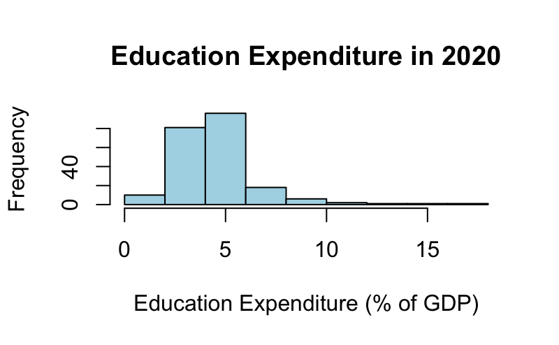
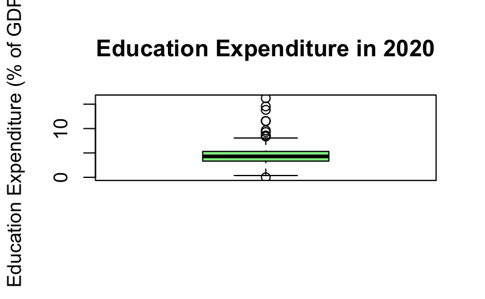

**Abstract:**

In this project, we are investigating how government expenditure on education relates to the overall GDP of the United States. Using data from the World Bank and real GDP data, we examine education spending as a percentage of GDP and compare it with changes in the country's economic output. Our current dataset contains seven years of U.S. education expenditure data, from 2015 to 2021. We found that the results show a positive correlation between education spending and real GDP levels. However, we also found that there was almost no correlation when comparing education spending with annual GDP growth. This shows that although both education spending and GDP levels may increase over time, we have not  yet found enough evidence to concretely relate higher education spending directly to economic growth. In the coming weeks, we plan to find more data sets to further prove this relationship. 

**Introduction:**

Education plays an important role in shaping the future of individuals and the overall economy of the United States. The amount of money the government spends on education can influence the quality of schools, the resources available to students, and the opportunities they have to succeed. Our central research question is: How does the United States' expenditure on its education system affect the country's overall GDP? We want to understand whether increased government investment in education contributes to long-term economic growth and whether spending more on education can have a positive impact on the country's economy.

This analysis may benefit students, particularly children living in low-income communities who often have less access to quality education and educational resources. By examining the relationship between education spending and GDP, we hope to better understand the economic value of investing in education. If our findings show a positive relationship between education expenditures and GDP, this could help support the argument that investing in education benefits not only individual students but also the country as a whole. This could provide further justification for allocating government funding toward schools and improving educational opportunities for communities that need them most.

The main goal of our project is to test the hypothesis that increased government spending on education is associated with an increase in overall US GDP. Rather than training a model to classify objects or predict categories, we are using historical economic data to investigate the relationship between two measurable variables: government education expenditures and GDP. We plan to examine trends over time, compare changes in education spending with changes in GDP, and use statistical analysis to determine whether a meaningful relationship exists between them. Through this analysis, we hope to gain a better understanding of how education investment relates to economic growth and whether increased spending on education may contribute to a stronger US economy.

**Executive Summary:**

-Our research examines whether increased government expenditure on education is associated with an increase in overall U.S. GDP
-Our World Bank dataset contains 6,372 observations across different countries and years, but only seven observations are available for the United States, covering 2015–2021
-U.S. education expenditure ranged from approximately 4.78% to 5.42% of GDP during the available years
-Our preliminary analysis found a positive correlation between education spending and real GDP levels, but almost no correlation between education spending and annual GDP growth
-More data and additional statistical testing are needed before we can determine whether increased education spending is meaningfully related to economic growth

**Data:**

Our data comes from the World Bank. The file is called WB_WDI_SE_XPD_TOTL_GD_ZS_WIDEF.csv. It shows how much each government spends on education, as a percent of that country’s GDP. The data is yearly, from 1970 to 2025. The file has 250 rows. Each row is a country or a group of countries, like “World” or “Euro area.” It has 95 columns. Most of them just describe the data, like the units. The other 56 columns are the years 1970 to 2025, and they hold the spending value for each year. The variables we use are the country name, the country code, the year, and education spending as a percent of GDP. A lot of the data is missing. About 54% of the country-year values are empty. Some years have much more data than others. There are 31 countries with data in 1970, 216 in 2020, and only 2 in 2025. 

To clean the data, we first read in the file and checked for repeated rows, and there were none. Then we kept only the country name, the country code, and the year columns. Next, we changed the table so that each row shows one country in one year. We also made sure that the year and the spending were stored as numbers. Finally, we removed the empty values. We removed only the empty values and not whole countries, because otherwise almost no data would be left. 

After cleaning, we have 6,372 observations. Spending averages 4.2% of GDP and ranges from 0% to 66.9%. A few very large values need to be checked. The United States has only 7 observations, from 2015 to 2021, between 4.8% and 5.4%.

**Visualization:**

To better understand the data, we created preliminary visualizations, including a histogram, boxplot, and a numerical summary. Our hypothesis stated that increased government spending on education will have a positive relationship with GDP because investing in education can help improve workers' skills, productivity, and economic growth.

The visualizations will help us examine the relationship between education expenditure and GDP in the United States over time. We plan to use a histogram to show how education spending as a percentage of GDP has changed throughout the years. We will also use box plots to compare education expenditure with GDP growth rates to determine whether higher education spending is associated with stronger economic growth. These statistics show that education spending varies across the observations in our dataset.

Our preliminary data shows that education expenditure varies over time, but further analysis is needed to determine whether these changes are related to GDP growth. We expect to find a positive relationship between education spending and economic performance. However, other factors, such as employment, inflation, and government policies, may also influence GDP. These visualizations will help us identify possible trends and determine whether our hypothesis is supported by the data.

```{r}


```

**Analysis:**

To further understand the relationship between education spending and GDP, we plan to use statistical methods to see how closely these two variables are related. We will start by calculating the correlation between education spending and GDP to see if they generally move in the same direction. We also plan to use linear regression to see if changes in education spending can help explain changes in GDP. Along with this, we want to compare education spending with annual GDP growth instead of only looking at GDP levels, since GDP naturally changes over time. 
So far, our results show a correlation of approximately 0.66 between education spending and real GDP levels. However, when comparing education spending with annual GDP growth, the correlation is approximately -0.01. This shows that even though education spending and GDP levels may increase together, that does not necessarily mean that spending more on education leads to higher economic growth. We also have to consider that education spending is measured as a percentage of GDP, so changes in GDP can affect that percentage as well. 
One of the biggest limitations we currently have is that our U.S. dataset only contains seven years of data, from 2015 to 2021. This makes it difficult to determine whether there is a strong relationship between education spending and GDP over a longer period of time. Moving forward, we plan to find more historical data and use additional statistical tests to get a better understanding of this relationship. We also want to look into whether increased education spending takes several years to have an effect on GDP, since improvements in education may take time to impact the workforce and the overall economy. By doing this, we hope to better understand whether investing more money into education can benefit both students and the U.S. economy as a whole. 

**Summary of Individual Contribution:**

